# 실험 데이터 처리 및 불확도 자동 계산 — 발표 자료

- 배포 주소: **https://uncertainty-lab.vercel.app**
- 만든 사람: 대전과학고 2307 송하율
- 이 문서는 **배포된 사이트 기준**으로 정리했다. 코드와 계산 검증 테스트(192개)는 저장소에 있다.

## 한 줄 소개

측정값을 엑셀에서 복사해 붙여넣고 계산식을 쓰면, 평균·표준편차·불확도와 **불확도 전파(자동 미분)**,
변수별 **오차 기여도**까지 자동으로 계산하고, **오차막대 그래프와 추세선**, 보고서에 넣을 표까지 만들어 주는 웹 서비스.

**왜 만들었나**: 실험 과목을 빼고 일반 과학 과목을 듣는 학생이 늘고 있는 이유는 실험 자체보다
실험 뒤의 데이터 처리 부담이 크기 때문이다. 특히 불확도 전파는 식마다 손으로 편미분해야 한다.
할 줄 몰라서가 아니라 **할 양이 많아서** 생기는 문제라 자동화에 적합하다.

---

## 1. 실제로 동작하는 기능

### 메인 기능

| # | 기능 | 하는 일 |
|---|---|---|
| 1 | **측정 블록** | 반복 측정값을 붙여넣으면 평균, 표본표준편차(n−1, 엑셀 `STDEV.S`와 같음), A형 표준불확도(s/√n)를 계산한다. B형 불확도(기기 최소눈금 등)를 넣으면 합성표준불확도 √(u_A²+u_B²)까지 구하고 `L = 1.0000 ± 0.0009 m` 형태로 보여준다 |
| 2 | **계산 블록** | `g = 4*pi^2*L / T^2`처럼 **이름으로 수식**을 쓰면, 위쪽 측정 블록의 평균을 값으로, 합성표준불확도를 불확도로 넣어 **자동 미분으로 불확도를 전파**한다. 결과는 유효숫자를 맞춰 `9.811 ± 0.015`로 보여주고, 변수별 **오차 기여도**를 막대로 그린 뒤 가장 큰 변수를 강조해 "어느 측정을 더 정밀하게 해야 하는지" 알려준다 |
| 3 | **그래프 블록** | x축·y축으로 측정 블록을 고르면 같은 순서의 값끼리 짝지어 점을 찍고, 각 블록의 B형 불확도로 **가로·세로 오차막대**를 그린다. **추세선 6종**(직선, 원점을 지나는 직선, 2차 곡선, 거듭제곱, 지수, 로그)과 **결정계수 R²**, 계수의 표준오차(`a = 4.04 ± 0.04`)를 보여준다. 최소제곱 계산과 SVG 그림은 모두 직접 구현했다 |
| 4 | **내보내기** | 측정 결과 표·계산 결과 표·그래프를 한 화면에 모아 보여주고, **표 복사**(워드·엑셀·구글문서에 붙여넣기)와 그래프 **PNG 저장·복사**(2배 해상도)를 한다 |
| 5 | **로그인과 실험 저장·불러오기** | 이메일+비밀번호로 가입·로그인하면 내 실험이 서버(Supabase)에 저장되어 **어느 기기에서든** 다시 열린다. DB의 행 단위 보안(RLS)으로 **내 실험은 나만** 볼 수 있다 |

### 서브 기능

**시작 화면**
- 내 실험 목록(최근 수정순 카드: 제목·수정 시각·블록 수), 제목 검색
- 새 실험 만들기, 실험 삭제(확인 창), 로그아웃
- 이 브라우저에 예전에 저장해 둔 실험이 있으면 "내 계정으로 가져오기"

**편집 화면**
- 실험 제목 수정, 각도 단위(도/라디안) 선택
- 블록 추가(측정·계산·그래프), 위·아래 이동(맨 위/맨 아래는 버튼 비활성화), 삭제
- **이름으로 참조**: 엑셀의 `B2` 대신 `L`, `T`. 계산 블록은 **자기보다 위의 블록만** 참조할 수 있어 순환 참조가 생기지 않는다
- 이름이 겹치면 경고, 이름을 바꾸면 **아래 수식 안의 이름과 그래프 축 이름도 함께 바뀐다** (이름 칸을 비운 순간에는 따라 바꾸지 않고 경고만 한다)
- 이름 변경·블록 이동으로 수식/그래프 축이 없는 이름을 가리키면 노란 경고
- 다른 블록이 쓰고 있는 블록을 지우려 하면 확인 창
- **자동 저장**: 수정을 멈추고 0.8초 뒤 저장, 위쪽에 "저장 대기 → 저장 중 → 저장됨", 실패하면 "다시 시도". 저장 전에 탭을 닫으려 하면 브라우저가 경고

**그래프와 내보내기**
- 점은 x축·y축 블록의 **같은 순서의 값끼리** 짝짓는다. 값 개수가 다르면 짧은 쪽에 맞추고 경고한다
- 축에는 측정 블록만 쓸 수 있고, 계산 블록·없는 이름·값이 없는 블록은 이유를 화면에 표시한다
- 추세선을 못 그리는 경우(점 부족, x가 모두 같음, 로그·거듭제곱에 0 이하 값 등)는 점만 그리고 이유를 안내한다
- 그림 안에 한글 축 이름·단위, 추세선 식, R²를 넣어서 **저장한 이미지만으로도 보고서에 쓸 수 있다**
- 내보내기 화면의 표와 그래프는 저장해 둔 것이 아니라 **열 때마다 원본에서 새로 계산**한다

**입력 편의와 안내**
- 붙여넣기: 엑셀의 줄바꿈·탭, 쉼표, 공백 구분을 모두 인식. 숫자가 아닌 조각(열 제목 등)은 계산에서 빼고 어떤 것을 뺐는지 알려준다
- 측정값이 1개면 표준편차를 계산할 수 없다고 안내(B형만 있으면 합성불확도는 계산)
- B형 입력이 잘못되면(문자·음수) 안내
- 수식 오류(덜 쓴 수식, 모르는 함수, 0으로 나누기, 위에 없는 이름)는 **이유를 화면에 표시**

**계산 규칙**
- 지원 연산 `+ - * / ^`, 괄호, 단항 `-`, 거듭제곱 우결합. 지원 함수 `sin cos tan asin acos atan exp ln log sqrt abs`, 상수 `pi`, `e`
- 도 단위일 때 **삼각함수 안에 들어가는 변수만** 라디안으로 바꾸고 값과 불확도를 함께 변환
- 유효숫자: 불확도는 1자리로 올림(첫 숫자가 1·2면 2자리), 값은 불확도 자릿수에 맞춰 반올림
- **계산 결과는 저장하지 않는다**: 원본 측정값과 수식만 저장하고 열 때마다 다시 계산하므로, 계산 방식을 고치면 예전 실험에도 자동 반영된다
- 파서와 자동 미분(전진 모드)은 외부 라이브러리 없이 직접 구현했다

**배포·품질**
- GitHub `main`에 푸시하면 Vercel이 자동으로 다시 배포. `/exp/…` 같은 주소를 새로고침해도 404가 나지 않는다
- API 키는 `.env`로 관리하고 GitHub에는 올리지 않는다(브라우저에 공개되는 publishable 키만 사용)
- 계산 테스트 192개: 엑셀 `STDEV.S` 값, 단진자 `g`의 손계산 값, 자동 미분 대 수치 미분, 도/라디안, 손으로 구한 회귀(`R² = 0.6`, 표준오차)와 6가지 추세선의 계수 복원

---

## 2. 아직 덜 됐거나 없는 기능

1차 버전의 기능(측정·계산·그래프·내보내기·로그인·저장)은 모두 만들어 두었다. 아래는 **일부러 넣지 않았거나 앞으로 피드백을 받아 정할 것**이다.

| 기능 | 지금 상태 |
|---|---|
| 계산 결과를 다른 계산 블록 수식에서 쓰기 | 안 된다. 수식에는 **측정 블록의 이름만** 쓸 수 있고, 계산 블록 이름을 쓰면 안내 문구가 뜬다 |
| 계산한 값(예: T²)을 그래프 축으로 쓰기 | 안 된다. 그래프 축은 측정 블록만 쓴다. T² 같은 값은 측정 블록에 직접 입력한다 |
| 점마다 다른 불확도, 오차막대를 반영한 가중 추세선 | 없다. 오차막대는 블록의 B형 불확도를 모든 점에 같게 쓰고, 추세선은 모든 점을 같은 비중으로 본다 |
| 2차 곡선 계수의 ± (표준오차) | 계산하지 않는다 (다른 5종은 계산한다) |
| 그래프 한 그림에 여러 데이터 | 없다 (그래프 블록 하나 = 그림 하나) |
| PDF·워드 파일로 내보내기 | 없다 (표 복사와 그래프 PNG 저장·복사만) |
| 비밀번호 재설정, 이메일 변경 | 없다 |
| 블록 드래그 이동 | 없다 (위/아래 화살표만) |
| 실험 이름 목록에서 바꾸기 | 없다 (편집 화면의 제목에서만) |

**알려진 한계** (발표 질문에 대비)
- 불확도가 올림으로 자리올림될 때(예: 0.00099 → 0.0010) 결과에 자릿수가 하나 더 붙는다. 예) `1.000 ± 0.001` 대신 `1.0002 ± 0.0010`. 값이 틀린 것은 아니고 표기 규칙의 경계 사례이다
- 도 단위에서 한 변수가 삼각함수 **안과 밖에 모두** 있으면(`sin(a) + a`) 안·밖 모두 라디안으로 바뀐다
- 변수들이 서로 **독립**이라고 가정한 전파 공식을 쓴다 (같은 측정값이 여러 변수에 섞이는 경우는 다루지 않는다)
- 그래프의 점은 **순서로 짝짓기** 때문에 x블록과 y블록의 값 순서가 같아야 한다
- R²는 직선·원점·2차·로그는 y값 기준이고, 거듭제곱·지수는 로그를 취한 값(ln y) 기준이다 (엑셀 추세선과 같은 방식)
- 이름 칸을 완전히 지웠다가 새로 쓰면 수식의 이름은 옛 이름 그대로 남고 "존재하지 않는 이름" 경고가 뜬다 (수식을 직접 고치면 된다). 이름을 **한 번에** 바꾸면 수식·그래프 축이 함께 바뀐다

---

## 3. 시연 순서 (가입부터 결과 확인까지)

예시는 **단진자로 중력가속도 측정** 실험이다. 길이 `L`(m)과 주기 `T`(s)를 5번씩 쟀고,
`g = 4π²L/T²`로 중력가속도와 불확도를 구한다. 화면에서 값이 이렇게 나오면 정상이다.

> 준비: 인터넷이 되는 브라우저에서 **https://uncertainty-lab.vercel.app** 을 연다.

### 1단계. 가입과 로그인
1. 주소를 열면 로그인하지 않았으므로 **로그인 화면**이 나온다.

   

2. 아래 **처음이에요 — 회원가입**을 누른다. 이메일과 **6자 이상** 비밀번호를 넣고 **회원가입**을 누른다.

   

   - 바로 시작 화면으로 가면 성공이다.
   - "메일함의 인증 링크를 누른 뒤 로그인해 주세요"가 뜨면 메일의 링크를 누르고 돌아와 **로그인**한다.
   - 다음부터는 같은 화면에서 이메일·비밀번호를 넣고 **로그인**만 누르면 된다.
3. 로그인하면 **시작 화면(내 실험)**이 나온다. 처음 가입했다면 "아직 실험이 없어요"가 보이고, 이미 만든 실험이 있으면 아래 그림처럼 카드로 보인다.

   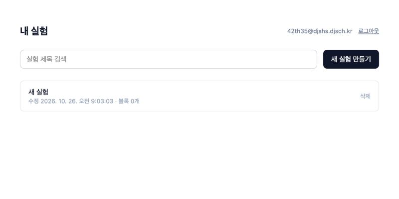

### 2단계. 새 실험 만들기
4. **새 실험 만들기**를 누른다. 편집 화면으로 넘어간다.
5. 맨 위 제목 칸을 눌러 `단진자로 중력가속도 측정`으로 바꾼다. 각도 단위는 그대로 둔다(이 예시는 삼각함수를 쓰지 않는다).
6. 위쪽의 "저장 대기 → 저장 중… → 저장됨" 표시가 보이면 자동 저장이 되고 있는 것이다.

   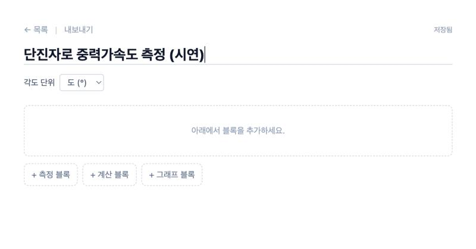

### 3단계. 측정 블록 두 개 (L, T)
7. 아래 **+ 측정 블록**을 누른다. 블록이 하나 생긴다.
8. 입력한다.
   - **이름**: `L`  **단위**: `m`
   - **반복 측정값**: 아래 5개를 붙여넣는다 (엑셀에서 세로로 5칸을 복사해 붙여넣어도 된다)
     ```
     1.001
     0.998
     1.002
     0.999
     1.000
     ```
   - **B형 표준불확도**: `0.0005` (자의 최소눈금 등)
9. 블록 아래에 결과가 나온다.

   | 항목 | 값 |
   |---|---|
   | 측정 횟수 n | 5 |
   | 평균 | 1 m |
   | 표준편차 s (n−1) | 0.00158114 m |
   | A형 u_A = s/√n | 0.000707107 m |
   | B형 u_B | 0.0005 m |
   | 합성 u_c | 0.000866025 m |
   | **결과** | **L = 1.0000 ± 0.0009 m** |

   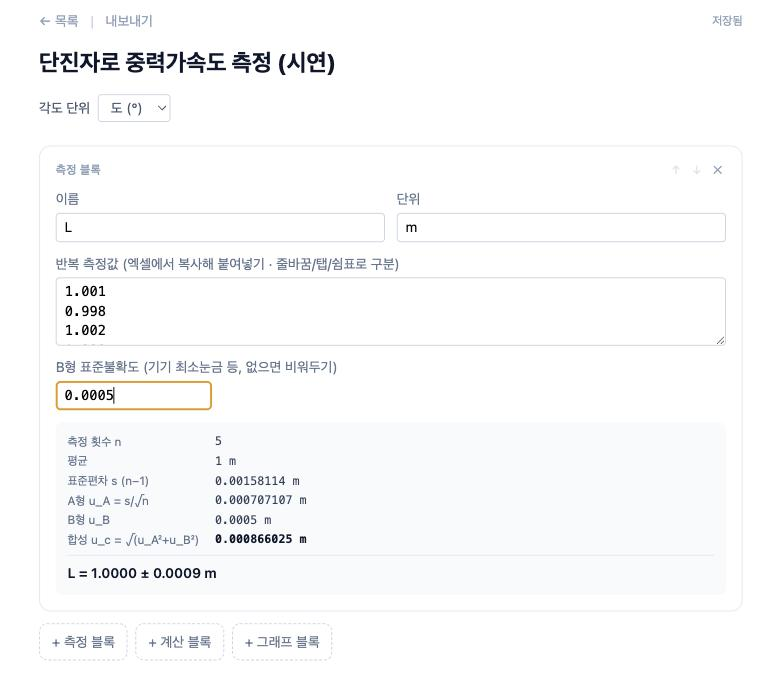

10. 다시 **+ 측정 블록**을 누르고 이번에는 이렇게 입력한다.
    - **이름**: `T`  **단위**: `s`
    - **반복 측정값**: `2.006`, `2.004`, `2.008`, `2.005`, `2.007` (한 줄에 하나씩)
    - **B형 표준불확도**: `0.001` (스톱워치 최소눈금)
11. 결과가 **T = 2.0060 ± 0.0013 s** (평균 2.006, s 0.00158114, u_A 0.000707107, u_c 0.00122474)로 나온다.

    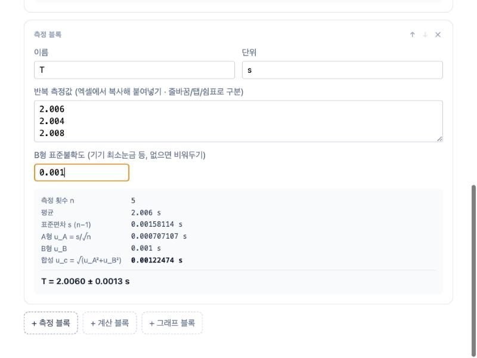

### 4단계. 계산 블록 (g)
12. **+ 계산 블록**을 누른다. "쓸 수 있는 변수: L, T"가 보인다(위쪽 블록의 이름만 쓸 수 있다는 뜻).
13. **이름**에 `g`, **수식**에 `4*pi^2*L / T^2` 를 입력한다.
14. 결과가 바로 나온다.
    - **g = 9.811 ± 0.015**
    - **변수별 오차 기여도**: T **66.5%**, L **33.5%** — 막대로 보이고 가장 큰 `T`가 파란색으로 강조된다
    - "가장 큰 기여: T — 이 측정을 더 정밀하게 하면 불확도가 가장 많이 줄어요."
    - "사용한 값: T = 2.0060 ± 0.0013 · L = 1.0000 ± 0.0009"

    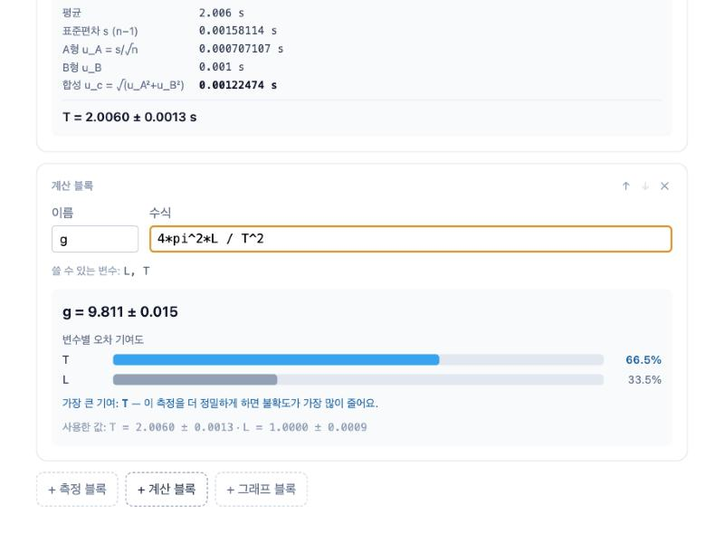

> 발표 포인트: 손으로 하면 `∂g/∂L = 4π²/T²`, `∂g/∂T = −8π²L/T³`을 직접 편미분해야 하지만, 여기서는 수식만 쓰면 자동 미분이 대신 한다. 오차 기여도를 보면 이 실험에서는 **주기 T 측정이 g의 불확도를 가장 크게 좌우**한다는 것을 바로 알 수 있다.

### 5단계. 이름 규칙 보여 주기 (선택)
15. **이름으로 참조하고, 이름을 바꾸면 수식도 따라 바뀐다**: 첫 번째 측정 블록의 **이름 칸을 전체 선택(⌘A)** 한 뒤 `len`을 입력한다. 아래 계산 블록의 수식이 `4*pi^2*len / T^2`로 **저절로** 바뀌고 결과는 그대로다. (이름 칸을 지웠다가 새로 쓰면 수식은 옛 이름 그대로 남으니, 전체 선택 후 바로 새 이름을 쓴다. 이유는 위 "알려진 한계" 참고)

    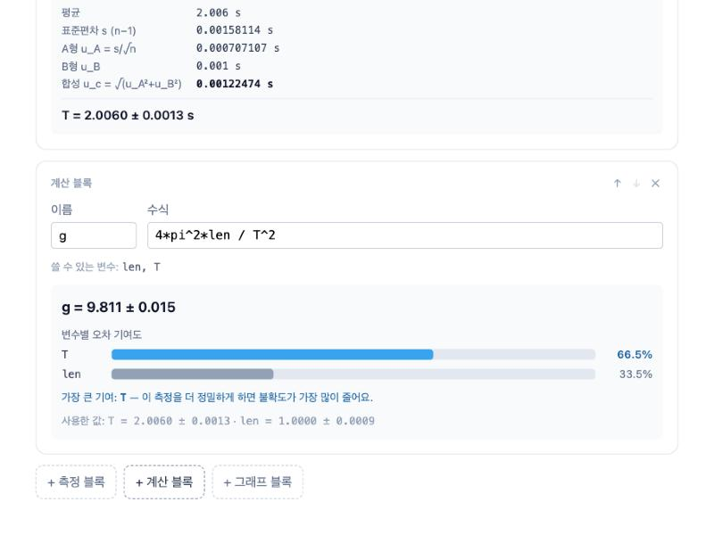

16. **참조가 끊기면 경고**: 계산 블록의 **↑** 를 눌러 측정 블록 위로 올린다. "쓸 수 있는 변수: 없음"과 노란 경고 "존재하지 않는 이름이에요", "계산할 수 없어요"가 뜬다. 다시 **↓** 로 내리면 원래대로 계산된다.

    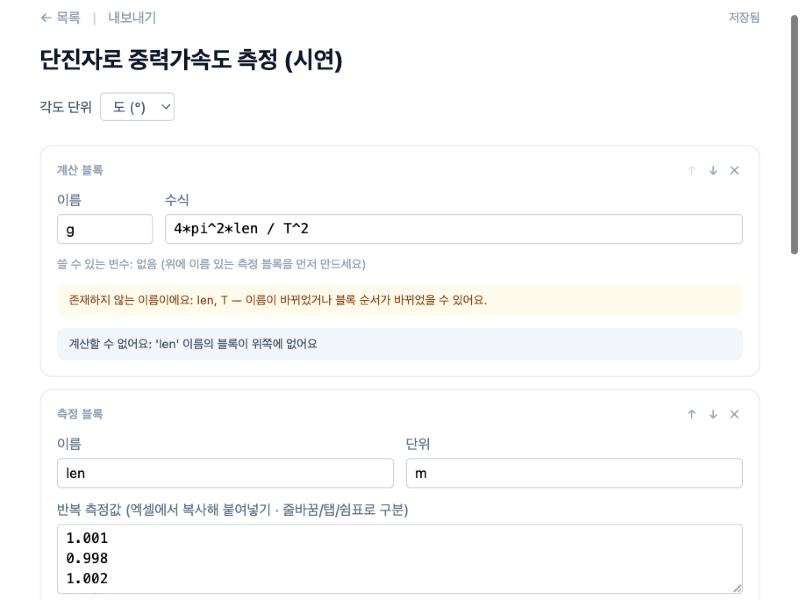

### 6단계. 그래프 블록 (오차막대와 추세선)
길이를 바꿔 가며 단진자의 주기를 쟀다고 하자. 이론적으로 **T² = (4π²/g)·L** 이라서 L–T² 그래프는 기울기 4π²/g인 직선이다. 새 실험에서 한다.

17. 시작 화면에서 **새 실험 만들기**를 누르고 제목을 `단진자 길이와 주기² 관계`로 바꾼다.
18. **+ 측정 블록**: 이름 `L`, 단위 `m`, 측정값 `0.40` `0.60` `0.80` `1.00` `1.20` (한 줄에 하나), B형 `0.02` (줄자를 읽는 오차)
19. **+ 측정 블록**: 이름 `T2`, 단위 `s²`, 측정값 `1.62` `2.40` `3.24` `4.01` `4.85`, B형 `0.10`
    - 여기서 5개의 값은 같은 양을 5번 반복한 것이 아니라 **길이를 바꿔 가며 잰 5개의 점**이다. 평균은 의미가 없으니 무시한다
20. **+ 그래프 블록**: **x축**에서 `L`, **y축**에서 `T2`를 고른다 (추세선은 처음에 **직선**).
21. 점 5개와 가로·세로 오차막대, 빨간 직선이 그려진다. 그림 안에 `T2 = 4.035·L − 0.004`와 `R² = 0.9998`이 보이고, 그림 아래에 `기울기 a = 4.04 ± 0.04 · 절편 b = −0.004 ± 0.028 · R² = 0.9998`이 나온다. 이 기울기에서 **g = 4π²/a ≈ 9.78 m/s²** 를 구할 수 있다.

    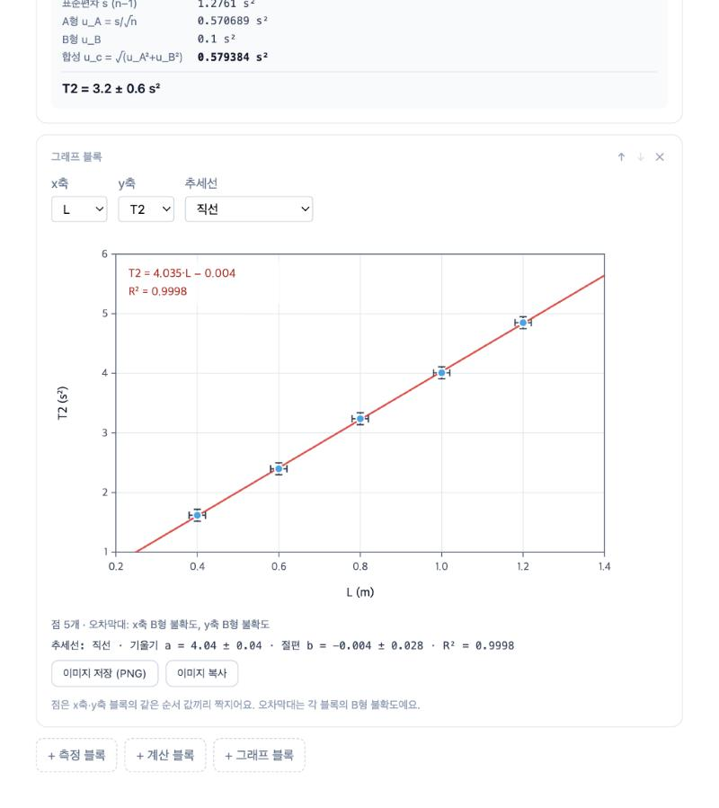

22. **추세선** 드롭다운을 바꿔 같은 데이터를 다른 모형으로 비교한다. R²가 모형이 데이터에 맞는 정도를 보여 준다.

    | 추세선 | 그림 안의 식 | R² |
    |---|---|---|
    | 직선 | `T2 = 4.035·L − 0.004` | 0.9998 |
    | 원점을 지나는 직선 | `T2 = 4.031·L` (기울기 4.031 ± 0.010) | 0.9998 |
    | 거듭제곱 | `T2 = 4.028·L^0.9984` (지수 b = 0.998 ± 0.008) | 0.9998 |
    | 2차 곡선 | `T2 = 0.08929·L² + 3.892·L + 0.046` | 0.9998 |
    | 로그 | `T2 = 2.901·ln(L) + 4.076` | 0.9726 |
    | 지수 | `T2 = 1.018·e^(1.353·L)` | 0.9762 |

    > 발표 포인트: **거듭제곱**의 지수가 0.998 ± 0.008로 1과 같으니 "T²는 L에 비례한다"는 것을 데이터로 확인할 수 있고, 로그·지수는 R²가 낮아 이 데이터에 맞지 않는 모형임이 드러난다. 시연이 끝나면 추세선을 다시 **직선**으로 돌려 둔다.

### 7단계. 내보내기 (보고서에 넣기)
23. 편집 화면 위쪽의 **내보내기**를 누른다. 측정 결과 표, (계산 블록이 있으면) 계산 결과 표, 그래프가 한 화면에 나온다. 3~4단계의 단진자 실험에서는 이렇게 나온다.

    | 표 | 내용 |
    |---|---|
    | 측정 결과 | `L = 1.0000 ± 0.0009 m`, `T = 2.0060 ± 0.0013 s` (n, 평균, 표준편차, u_A, u_B, u_c 포함) |
    | 계산 결과 | `g = 4*pi^2*L / T^2` → `9.811 ± 0.015`, 오차 기여도 `T 66.5%, L 33.5%` |

    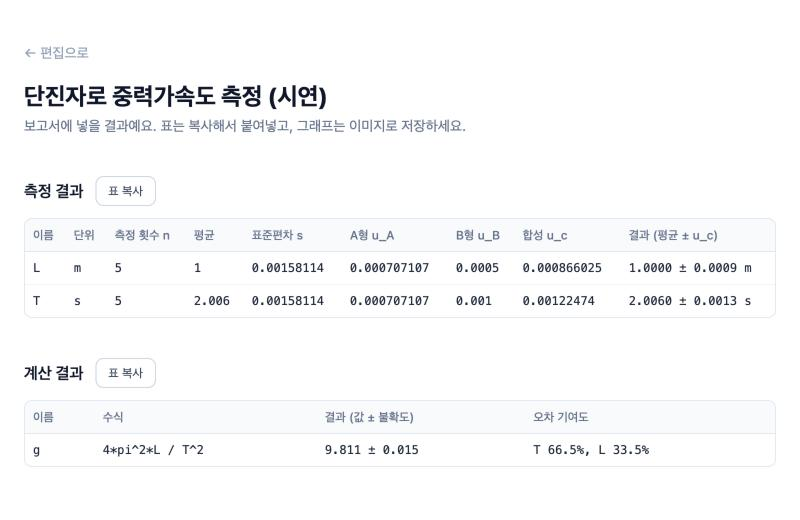

24. **표 복사**를 누르고 워드·구글문서·엑셀에 붙여넣는다. 워드·구글문서에는 **서식 있는 표**로, 엑셀에는 **칸이 나뉜 값**으로 붙는다.
25. 6단계의 그래프가 있는 실험에서는 아래에 그래프가 나온다. **이미지 저장 (PNG)** 을 누르면 `T2-L.png`(1280×840, 화면의 2배 해상도)가 저장되고, **이미지 복사**를 누르면 문서에 바로 붙여넣을 수 있다.

    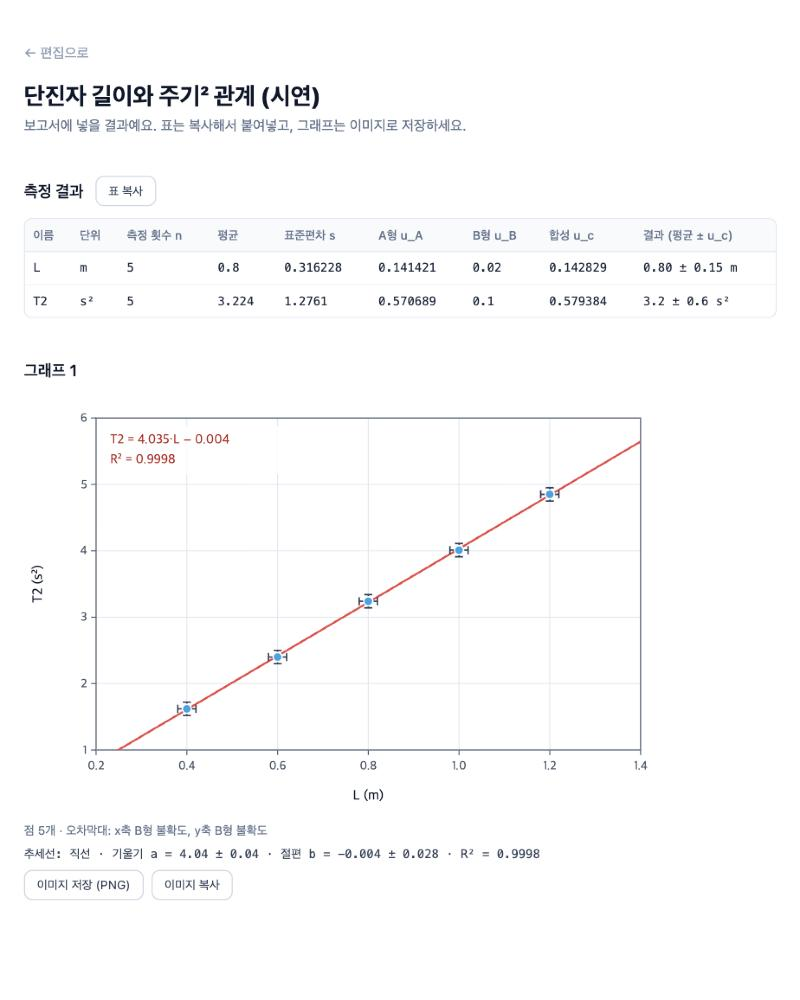

### 8단계. 저장 확인과 로그아웃
26. 브라우저를 **새로고침(⌘R)** 한다. 로그인이 유지되고 입력한 값과 결과가 그대로 있다.
27. 위쪽 **← 목록**을 누르면 시작 화면에 이 실험이 카드로 있다. (제목, 수정 시각, 블록 3개)

    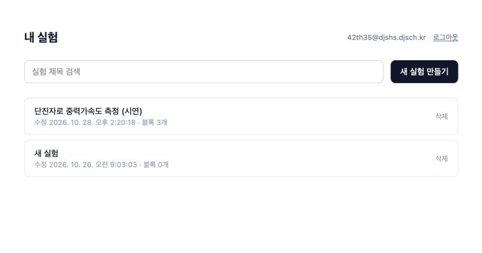

28. 오른쪽 위 **로그아웃**을 누르면 로그인 화면으로 돌아간다. 다시 로그인하면 같은 실험이 열린다. (다른 컴퓨터에서 로그인해도 같다)

### (덤) 삼각함수 예시: 굴절률
도 단위에서 삼각함수가 어떻게 처리되는지 보여 주고 싶을 때. 각도 단위가 **도(°)** 인지 확인하고,
측정 블록 `a`(단위 °, 값 `45.0 45.2 44.9 45.1`, B형 `0.2`), `b`(값 `28.0 28.2 27.9 28.1`, B형 `0.2`)를 만든 뒤
계산 블록 `n`에 `sin(a)/sin(b)`를 쓰면 **n = 1.505 ± 0.012** (b 77.9%, a 22.1%)가 나온다.
